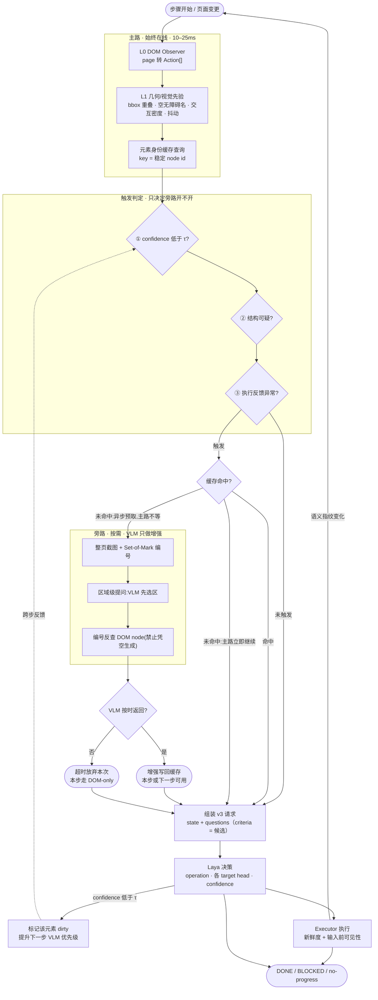
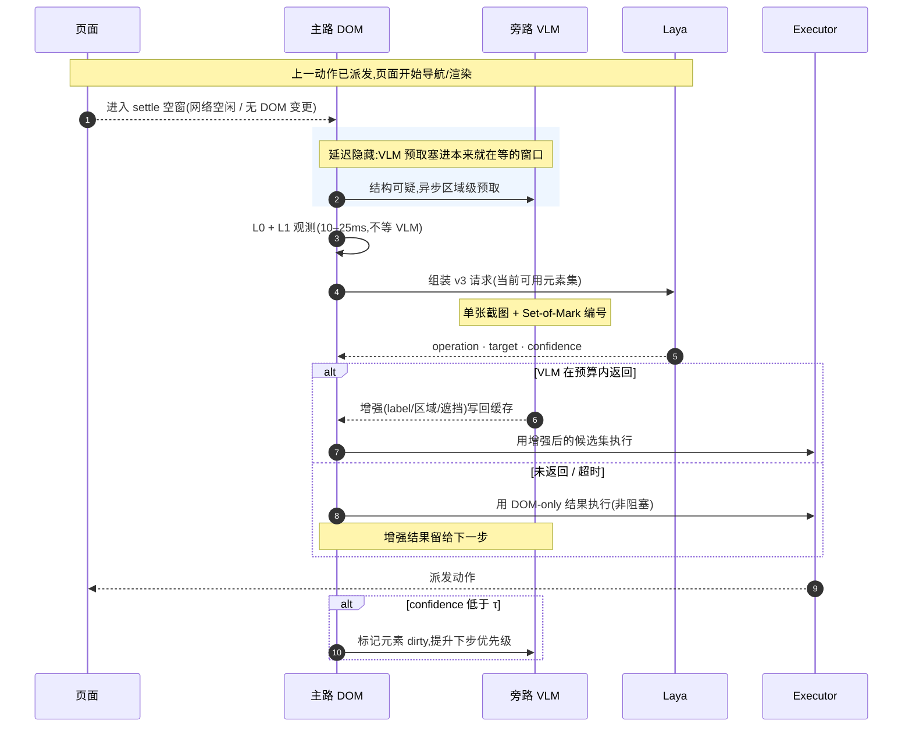

# 浏览器自动化 Agent —— 集成 Laya 推理接口的完整实现提示词

> 把这份文档整段交给一个编码 Agent(或开发者),它应当能在不追问的前提下,
> 基于本仓库的 `/v1/systemone` 推理服务实现一个可运行、可验证的浏览器驱动 Agent。
> 文档中所有"硬约束"都来自实测(见 `benchmark/CONTAMINATION.md`、`e2e/README.md`),
> 违反它们会让评测结果失真。

---

## 0. 角色与目标

你是一名资深浏览器自动化工程师。请实现一个 **决策由模型给出、执行由代码掌控** 的浏览器 Agent:

- **模型侧**:一个 Laya System-1 决策模型,通过 HTTP `POST /v1/systemone` 调用。
- **执行侧**:由你的代码用 Playwright 驱动真实 Chrome。
- **目标**:给定一句自然语言研究目标,Agent 在真实网站上完成它,并且**每一步都可审计、结果可独立验证**。

**核心信条(不可妥协)**:模型只能从"已观测到的元素"里做**有限离散选择**;它不生成选择器、不生成坐标、不生成脚本。代码负责把选择翻译成真实操作,并负责一切校验。

**Observer 信条**:DOM 主路永远在线、永不阻塞;VLM 只在被触发时作为**旁路增强**介入,且只能改元素属性、不能新增节点(§2)。

---

## 1. 推理接口契约(硬约束)

### 1.1 端点

```
POST {BASE_URL}/v1/systemone
Content-Type: application/json
Authorization: Bearer <key>      # 仅当服务端设了 INFER_API_KEY
```

`GET /health` 用于就绪探针;`GET /v1/models` 列出可用 checkpoint。

### 1.2 请求

```json
{
  "model": "可选，服务端识别的 id 才会生效，否则自动选择",
  "state": { ... },
  "questions": { "<id>": { "type": "...", "instructions": ..., "criteria": ... } }
}
```

### 1.3 响应

```json
{
  "model": "laya-rl-agent",
  "answers": {
    "<id>": {
      "type": "choice",
      "choice": "billing",
      "probabilities": {"billing": 0.94, "technical": 0.04, "other": 0.02},
      "confidence": 0.7589,
      "answer_confidence": 0.9603,
      "action": {"act_probability": 1.0}
    }
  },
  "usage": {"input_tokens": 121, "output_tokens": 0}
}
```

### 1.4 状态码语义(必须区分处理)

| 码 | 含义 | 你的处理 |
|---|---|---|
| 200 | 成功 | 解析 `answers` |
| 400 | JSON 格式错 / 缺 `questions` | 代码 bug,不要重试 |
| 401 | Bearer 无效 | 配置错误,不要重试 |
| 413 | body>2MiB / 问题>64 / state>5万字符 | **必须裁剪后重发**(见 §3.2) |
| 422 | 问题定义了错(如非法 type、选项放不下) | 代码 bug,记录并终止该步 |
| 500 | 推理失败 | 可退避重试 1 次 |
| 503 | 后端未就绪 | 等待后重试 |

### 1.5 三个绝对不要做的事

1. **不要把候选元素塞进 `state`**。v3 格式要求元素**只出现在 `questions.*.criteria`**。把元素表放进 state 会被 1024 token 窗口截断,模型根本看不到该选谁——这是官方微调文档里"最有价值的单个改动"。
2. **不要用 `action.act_probability` 做门控**。官方明确说明该字段暂无可用信号(几乎恒为 1.0)。门控用 `confidence`。
3. **不要把模型的 `DONE` 当作任务成功**。成功必须由独立验证器判定(§6)。

---

## 2. 架构:主路 DOM + 旁路 VLM

### 2.0 组件

```
┌─────────────────────────────────────────────────────────────┐
│                       Agent Loop                            │
│                                                             │
│  ┌──────────┐   ┌──────────────┐   ┌───────────┐            │
│  │ Observer │──▶│ Decision     │──▶│ Executor  │            │
│  │ 主路+旁路 │   │ (Laya HTTP)  │   │ (Playwright)│           │
│  └──────────┘   └──────────────┘   └───────────┘            │
│        ▲                                  │                 │
│        │            ┌──────────────┐      │                 │
│        └────────────│ Validator    │◀─────┘                 │
│                     │ (5 层校验)    │                        │
│                     └──────────────┘                        │
│                                                             │
│  ┌──────────────────────────────────────────────────────┐   │
│  │ Trajectory: [StepRecord]  (审计 + 终止判定输入)         │   │
│  └──────────────────────────────────────────────────────┘   │
└─────────────────────────────────────────────────────────────┘
                              │
                              ▼
                 ┌────────────────────────┐
                 │ Independent Verifier   │  最终成功与否由它判定
                 └────────────────────────┘
```

| 组件 | 职责 | 不负责 |
|---|---|---|
| `Observer` | 页面 → 元素表 + 语义指纹;主路 DOM 永远在线,旁路 VLM 按需增强 | 不决策、不执行、**不猜节点** |
| `DecisionClient` | 打包请求、调用 Laya、解析答案 | 不接触浏览器 |
| `Executor` | 把选中的动作施加到页面 | 不决策 |
| `Verifier` | 检查最终页面是否满足任务 | 不参与过程 |

### 2.1 为什么要主/旁两路

一个 VLM(同时看 DOM + 截图)做 Observer 最准,但**不可能每次 page change 都调一次**:单次调用几百毫秒到数秒,而一步决策总共只有几十毫秒预算。结论是把 VLM 当成**主路的修复层(旁路)**,而不是主路本身。

Observer 分四层,上层按需启用,下层永远在线:

| 层 | 内容 | 频率 | 预算 |
|---|---|---|---|
| **L0** | DOM Observer:枚举交互元素 → `Action[]`,分配稳定 `node id` | 每步 | 1–10ms |
| **L1** | 几何 / 视觉先验:bbox 重叠、无障碍名空洞、交互密度、多帧抖动 | 每步 | 5–20ms |
| **L2** | VLM 增强:label、区域、遮挡、分组 | 按需触发 + 缓存 | 不等(旁路) |
| **L3** | LLM 复核:仅在与 Laya 决策严重冲突时抽检 | 极稀疏 | 不等(后台) |

主路只依赖 L0+L1:

- **L0+L1 永远在线**,负责"有哪些元素、能不能点"。
- **L2 按需触发、结果缓存**,只负责"这个元素叫什么、在哪个区域、有没有被遮挡"这类**元素属性**。

**关键洞察——按元素身份缓存,而不是按页面状态缓存**:L0 已经给每个元素发了稳定 `node id`(见 §3.1)。VLM 的输出描述的是**元素属性**,所以缓存 key 是 `node id`,不是整页快照。同一元素换页再出现、或同页元素反复被引用时,直接命中缓存,不必重算。实测目标是把 VLM 调用率压到 **<20–30%**(必须在本地实测,不要假设)。

### 2.2 主路 / 旁路结构



读图要点:`CACHE` 的三条出边中,`→ SHOT`(开旁路)与 `→ BUILD`(主路继续)是**同时发生**的——旁路开跑时主路已经往下走;`DIRTY -.-> T1` 是跨步反馈,不是本步重试。

### 2.3 延迟控制时序



### 2.4 VLM 触发条件

| 类别 | 信号 | 何时可得 | 来源 | 触发后 |
|---|---|---|---|---|
| ① 决策置信度 | Laya `confidence` 低于 τ(默认 0.35;官方 AUROC≈0.77,**不要**用 `act_probability`) | Laya 返回后 | 响应体 | 标记元素 `dirty`,提升**下一步**优先级;同页可做区域级重观测 |
| ② 结构可疑 | 交互元素数远小于页面规模;bbox 重叠;无障碍名为空;几何多帧抖动 | 决策前(L0/L1) | DOM + 几何先验 | 立即异步预取 VLM |
| ③ 执行反馈异常 | 连续 `page_changed=False`;`StalePage` / `ActionFailed` 频发 | 执行后、下一步前 | Executor | 结构性重观测 + 预取 VLM |

**关键区分**:②③ 是**决策前**信号,所以能并发预取、用于藏延迟;① 是**决策后**信号,只能回流去 arm 下一步。把 ① 当成"本步立刻再调 VLM",就退化成"每步一次",正是要避免的。

### 2.5 延迟控制手段

| 手段 | 做法 | 收益 |
|---|---|---|
| 预取 / 推测 | 在 settle 空窗并发发起 VLM,不等 Laya | 把 VLM 延迟藏进本来就在等的窗口 |
| 非阻塞首步 | 首步永远 DOM-only,VLM 结果随后进缓存 | 首次决策零额外延迟 |
| 单帧批量 | 每页只截一张,多区域 / 多问题合并成一次调用 | 调用数与延迟各降一个量级 |
| 超时即弃 | 给 VLM 一个小预算,超时放弃本次、主路继续 | 最坏延迟有上界 |
| 元素级缓存 | 增强挂在稳定 `node id` 上,命中不重算 | 同页重复元素、回退旧页近乎零成本 |

### 2.6 硬不变量与注意事项

1. **DOM 是元素存在性与身份的唯一权威**。VLM 只能改 label / 顺序 / 区域 / 遮挡,**不能新增 node**;靠 Set-of-Mark 编号反查 DOM 节点强制这一点。
2. **每条增强必须可追溯到 `node id`**。没有身份就不能进候选集,否则 VLM 幻觉会带进一个不存在的目标。
3. **旁路永不阻塞主路**。有超时预算,超时按 DOM-only 走。
4. **触发阈值与调用率要实测**。目标 VLM 调用率 <20–30%,并在"被触发样本"上量准确率增益;只看设计图合理不算数。
5. **纯视觉界面要单开分支**。canvas / 游戏 / 远程桌面没有 DOM 节点可锚定,会打破 `node` 模型,需单独的坐标点击分支,不能硬塞进本流程。
6. **VLM 只是可选增强**。关闭 VLM 时,整个 Agent 必须仍能按 §4 循环跑通——旁路是加成,不是依赖。

---

## 3. 数据结构(重点)

以下 schema 是"外围支撑"的核心。**类型不确定处宁可用 dict + 显式校验,不要用无校验的自由结构**——这个 Agent 的失败模式几乎都是"结构对了但语义错了"。

### 3.1 元素表 `Action[]`

观测与执行之间的唯一桥梁。**`id` 是代码自有的,不是 DOM 的。**

```python
Action = {
    "id": str,              # 代码自有稳定 id,如 "click:12" / "fill:12" / "select:12:3"
    "kind": str,            # "click" | "fill" | "select" | "wait" | "scroll" | "enter"
    "label": str,           # 可访问名称(优先 aria-label / labels / alt / title / placeholder / innerText)
    "role": str,            # button|link|textbox|searchbox|combobox|checkbox|...
    "node": int,            # 代码自有节点标识(正数);页级动作为 0
    "value": str,           # fill/select 的值
    "current_value": str,   # 字段当前显示值(关键:模型靠它避免重复填)
    "checked": str,         # 可选 "true"/"false"
    "selected": str,        # 可选
    "expanded": str,        # 可选
    "delta": int,           # 仅 scroll
}
```

**设计要点**

- **一个元素一个 `node`**,即使它同时可点可输入——否则同一个控件会有两个编号,模型会在两者间犹豫。
- **`id` 里编码 kind**,因为同一个 `node` 可能有 `click:12` 和 `fill:12` 两个合法动作(如可编辑的 combobox)。
- **`node` 必须跨观测稳定**:用 `WeakMap<Element,int>` 分配并复用,元素消失后其编号不复用。它同时是旁路 VLM 增强的缓存 key(§2.1)——稳定性不只是审计好看,而是正确性要求。
- **`current_value` 必须真实反映现状**。我们实测中"字段已填却重复填"是高频失败,正是靠它让模型看出"已填"。
- **页级动作 `node=0`**,不参与 target 选择。

### 3.2 观测 `Observation`

```python
Observation = {
    "url": str,
    "title": str,
    "text": str,            # 可见文本, ≤ 1200 字符(v3)
    "actions": Action[],    # 建议 ≤ 250 条,超出截断
    "marker": str,          # 语义指纹,见 §5.3
    "scroll": {"y": int, "height": int},
    "count": int,
}
```

**为什么 `text` 截断到 1200 字符**:v3 下 `state` 只能占 `max_len - head_max_len` 的预算,文本过长会挤掉 option 的 token、摊薄候选描述。官方实测:截到 3000 字符省不了时间还掉 0.04 top-1,1200 是让 322M 模型跑到 ~20ms/步的甜点。

**为什么 `actions` 截断到 250**:再多会显著拉长序列、淹没关键项。截断时**优先保留 `text` 区域内、高概率相关的元素**。

### 3.3 问题 `Question`

```python
Question = {
    "type": "choice" | "score" | "noul",
    "instructions": str | dict,   # 浏览器场景用 dict: {"goal": ..., "rules": ...}
    "criteria": dict | list,      # choice: {key: 描述};score: [档位];noul: 省略
}
```

**三个不可违反的构造规则**

1. **每个 target 问题都要带完整 goal**。问题之间**独立并行计算**,`click_target` 读不到 `operation` 的答案,所以它的 `instructions` 必须自己声明前提:`{"goal": goal, "operation": "CLICK"}`。
2. **target 候选必须与操作兼容**。`click_target` 只能包含可点元素,`type_text_target` 只能包含可编辑字段。执行时**只消费与所选 operation 匹配的那一个 head**,其余丢弃。
3. **候选描述要能区分彼此**。`"4": "出发城市 请输入城市"` 远好于 `"4": "输入框"`。描述是模型唯一的区分依据。

**投机式 target head**:一次请求同时算出 `operation` + 所有 `*_target`,避免"先问操作、再问目标"的两次往返。这是 ~2× 延迟的来源。

### 3.4 答案 `Answer`

```python
Answer = {
    "type": str,
    "choice": str,                  # choice 类型:argmax
    "probabilities": {str: float},  # 全分布,和为 1(±0.02)
    "confidence": float,            # 门控用这个
    "answer_confidence": float,     # 选中项的概率
    "score": float,                 # score 类型
    "legend": {str: str},           # score 类型
    "noul": float,                  # noul 类型:为真的概率
}
```

### 3.5 决策 `Decision`(代码归一化后的)

**不要把原始 Answer 直接传给执行器**。先归一化成代码可校验的结构:

```python
Decision = {
    "operation": str,               # 归一化后的操作键
    "operation_confidence": float,
    "target_key": str | None,       # criteria 里的 key
    "target_label": str | None,     # 便于日志/审计
    "kind": str | None,             # 归一化后的执行 kind
    "resolve": Action | None,       # 从元素表反查出的真实动作
    "latency_ms": float,
    "request": dict,                # 便于复现
}
```

### 3.6 轨迹 `StepRecord[]`

既是审计日志,也是**终止判定的输入**:

```python
StepRecord = {
    "step": int,
    "operation": str,
    "confidence": float,
    "target": str | None,
    "label": str | None,
    "kind": str | None,
    "text": str | None,             # fill 时实际输入的值
    "outcome": str,                 # executed | stale | failed | invalid-target | done | blocked
    "page_changed": bool,           # 执行前后 marker 是否变化 ← 关键
    "url": str,
    "elapsed_ms": float,
}
```

**`page_changed` 是防死循环的核心信号**。连续多次 `page_changed=False` 且 kind 不是 `wait`,说明 Agent 卡住了(点了不生效的按钮 / 撞上验证码页 / 操作被遮挡)。

---

## 4. 决策循环

```
observe → validate(观测) → build_request → 调用 Laya → validate(答案)
        → 归一化 Decision → validate(决策:索引存在性)
        → 新鲜度校验 → 执行 → validate(执行结果) → 记录 → 重复
```

**每步的伪代码**

```
obs = observe(page)                                  # L0+L1;L2 旁路异步,不在此等待
if not obs: raise
state, questions, targets, controls = build_request(obs, goal, history)
answers = client.predict(state, questions)          # HTTP

op = answers["operation"]["choice"]
if op not in questions["operation"]["criteria"]:  → 代码 bug,终止

if op in ("DONE", "BLOCKED"):
    record; break
if op in controls:            # 页级动作:wait / scroll / enter
    action = controls[op]
else:
    tq = op.lower() + "_target"
    if tq not in answers:       → 该操作无 target head,视为失败并重观测
    key = answers[tq]["choice"]
    if key not in targets[op]:  → invalid-target,重观测(不要瞎猜)
    action = targets[op][key]

text = text_model(context) if action.kind == "fill" else None
if not fresh(page, obs):        → stale,丢弃决策,重观测
execute(page, action, text=text)
new_obs = observe(page)
record(page_changed = new_obs.marker != obs.marker)
```

---

## 5. 代码验证(重点)

**五层校验,每层都必须有明确的拒绝路径。** 这个 Agent 的绝大多数事故来自"某层没校验,错误被静默传播"。

### 5.1 第一层:请求校验(发送前)

在打包阶段就阻止无效请求,避免浪费一次网络往返:

```python
def validate_request(state, questions, limits=Limits()):
    assert isinstance(questions, dict), "questions 必须是对象"
    if len(questions) > limits.max_questions:            # 64
        raise RequestTooLarge("问题过多")
    size = len(state) if isinstance(state, str) else len(json.dumps(state, ensure_ascii=False))
    if size > limits.max_state_chars:                    # 50000
        raise RequestTooLarge("state 过大")

def validate_question(q):
    assert q["type"] in ("choice", "score", "noul"), f"非法 type: {q['type']}"
    if q["type"] == "choice":
        assert isinstance(q["criteria"], dict) and q["criteria"], "choice 需要非空 criteria"
    if q["type"] == "score":
        assert isinstance(q["criteria"], list) and len(q["criteria"]) >= 2
```

**必须处理的 413**:收到 413 时**不要重试原请求**,要按 §3.2 裁剪 `text` 和 `actions` 后重发。

### 5.2 第二层:答案校验(接收后,使用前)

**模型的输出必须被当作不可信输入对待。**

```python
def validate_answer(ans, question) -> Answer:
    keys = set(question["criteria"].keys()) if question["type"] == "choice" else None

    if question["type"] == "choice":
        p = ans.get("probabilities")
        if not isinstance(p, dict):                       raise InvalidAnswer("缺 probabilities")
        if keys is not None and set(p) != keys:           raise InvalidAnswer("概率键与候选不符")
        nums = [*p.values(), ans.get("confidence", 0)]
        if not all(isinstance(n,(int,float)) and math.isfinite(n) and 0<=n<=1 for n in nums):
                                                          raise InvalidAnswer("概率非法")
        if abs(sum(p.values()) - 1) >= 0.02:              raise InvalidAnswer("概率和不为 1")
        if ans["choice"] not in keys:                     raise InvalidAnswer("选择不在候选中")
        if p[ans["choice"]] < max(p.values()) - 1e-6:     raise InvalidAnswer("choice 不是 argmax")

    if question["type"] == "noul":
        v = ans.get("noul")
        if not (isinstance(v,(int,float)) and 0 <= v <= 1): raise InvalidAnswer("noul 非法")
    return ans
```

**为什么这条要严格**:一个"概率键与候选不符"意味着模型答的是别的题的分布,直接用它就是随机执行。

### 5.3 第三层:新鲜度校验(执行前,**最关键**)

**用语义指纹,不要数 DOM 变更次数。** 动画会持续改 DOM,数变更会把每个决策都判为过期(官方原版就因此慢了 25%)。

```python
def marker(obs) -> str:
    payload = {
        "url": obs["url"],
        "title": obs["title"],
        "text": obs["text"],
        "semantics": [[a["id"], a["kind"], a["label"], a.get("value"), a.get("current_value")]
                      for a in obs["actions"]],   # 只比较语义,不含几何
    }
    return hashlib.sha256(json.dumps(payload, sort_keys=True, ensure_ascii=False).encode()).hexdigest()

def fresh(page, obs) -> bool:
    if page.url != obs["url"]:        # URL 变化是最常见的过期情形,先短路
        return False
    return marker(observe(page)) == obs["marker"]   # 需要时再做全量比对
```

**过期时的正确行为**:抛 `StalePage`,**丢弃该决策**,重新观测、重新决策。**绝不**拿旧决策在新页面上执行。

### 5.4 第四层:执行校验(输入前一刻)

**几何和可见性必须在输入前重新解析**,不能用观测时的旧数据:

```python
def validate_target(page, node):
    el = resolve_node(page, node)          # 代码自有 node → 真实元素引用
    if el is None or not el.is_connected:          raise StalePage("元素已消失")
    if el.is_disabled() or el.has_aria_disabled(): raise StalePage("元素被禁用")
    box = el.bounding_box()
    if not box or box["width"] <= 0 or box["height"] <= 0: raise StalePage("不可见")
    if not el.check_visibility():                  raise StalePage("被遮挡")
    if not el.is_in_viewport():                    raise StalePage("不在视口内")
    return el
```

**为什么 `node` 而不是 CSS 选择器**:`node` 指向代码持有的真实 DOM 引用,模型无法编造一个页面上不存在的目标;而 CSS 选择器是可注入的字符串。这是"代码掌控执行"的具体体现,也是 §2.6 不变量 1/2 的执行落点。

### 5.5 第五层:结果校验(执行后)

```python
# 1. 执行是否真的发生了
new_obs = observe(page)
changed = new_obs["marker"] != obs["marker"]
record(page_changed=changed)

# 2. 无进展检测
recent = [s["page_changed"] for s in trajectory[-4:]]
if len(recent) == 4 and not any(recent) and trajectory[-1]["kind"] != "wait":
    terminate("no-progress")     # 防止把预算耗在同一个无效动作上

# 3. 独立任务验证(见 §6)
```

### 5.6 归一化与终止

```python
def normalize_operation(op, targets, controls) -> str:
    if op in ("DONE", "BLOCKED"):   return op
    if op in targets:               return op           # CLICK / TYPE_TEXT / SELECT
    if op.upper() in {k.upper() for k in controls}: return op.upper()  # WAIT / SCROLL_DOWN / ENTER
    raise InvalidOperation(op)      # 不认识 → 代码 bug
```

**终止条件(任一即停)**

| 条件 | 状态 | 说明 |
|---|---|---|
| 模型选 `DONE` | done | 但**成功与否由验证器决定** |
| 模型选 `BLOCKED` | blocked | 模型自认无路可走 |
| 步数 ≥ `MAX_STEPS` | max-steps | 建议 25 |
| 模型调用 ≥ `MAX_OPERATION_REQUESTS` | budget | 建议 60 |
| 连续 4 步 `page_changed=False` | no-progress | **防死循环的关键** |
| 连续 3 步同一 operation+target | repeat-loop | 更强的重复检测 |
| 连续 3 次无效决策 | invalid-decisions | 见下方陷阱 |

**陷阱:无效决策必须计入守卫。** 实测中发现两个真实 bug,都由"无效路径绕过了守卫"引起:

1. **重置时机错**:如果"有效 operation"就重置无效计数,那么"operation 合法但 target 非法"会永远重置,防线失效。**只在真正执行成功后重置**。
2. **`continue` 绕过守卫**:`invalid-target` 分支若直接 `continue` 回观测,一个持续输出非法目标的模型会把步数预算耗尽而不是尽早停止。无效路径**也必须累加计数并检查**。

```python
if action is None:                      # 非法 target
    record(outcome="invalid-target")
    invalid_streak += 1
    if invalid_streak >= MAX_INVALID_STREAK:   # 必须在 continue 之前
        terminate("invalid-decisions")
    continue

executor.act(...)
invalid_streak = 0                      # 只有执行成功才重置
```

**置信度门控**

`confidence` 用于两件事:① 触发旁路 VLM(**只 arm 下一步**,见 §2.4 触发条件 ①);② 报告不确定。

```python
ESCALATE_TAU = 0.35
if decision.operation_confidence < ESCALATE_TAU:
    mark_dirty(decision.resolve.node)   # 提升下一步 VLM 优先级;不要本步立刻再调 VLM
    # 可选:选 WAIT 让页面稳定;或终止并报告"不确定"
```

注意:官方实测发现"置信度门控升级到 8B/27B"**反而更差**——微调后的 322M 比通用大模型判断更准,除非你有显著更强的老师。没有强老师时,门控应当用于**报告不确定**,而不是自动升级。

---

## 6. 独立验证器(不能用 DONE 当成功)

```python
def verify(task, final_page) -> Verdict:
    text  = final_page["text"].lower()
    title = final_page["title"].lower()
    url   = final_page["url"].lower()
    hay   = f"{url}\n{title}\n{text}"

    # 第一件事:拒绝 bot 验证码页,否则验证码会被误判为成功
    if ("sorry/index" in url) or ("unusual traffic" in text) \
       or ("complete the following challenge" in text) or ("not a robot" in text):
        return Verdict(passed=False, reason="bot_challenge")

    # 任务特定证据:只有真的做了调研才会出现的字符串
    for group in task.require_any:                 # 每组至少命中一个
        if not any(g.lower() in hay for g in group):
            return Verdict(passed=False, reason=f"missing {group}")
    if any(f.lower() in hay for f in task.forbid):
        return Verdict(passed=False, reason="forbidden content")
    if task.expect_url_contains and task.expect_url_contains.lower() not in url:
        return Verdict(passed=False, reason="wrong site")

    return Verdict(passed=True)
```

**最终成功判定**

```python
success = verifier_passed and (status == "done")
independently_verified = verifier_passed       # 单独报告,更公平
```

分开报告的原因:我们实测发现模型经常**找到了正确页面却不肯停**(3/6 独立验证通过但 0/6 成功)。混在一起会掩盖"目标选择其实是对的"这一重要事实。

---

## 7. 已知失败模式(来自真实评测)

| 现象 | 根因 | 缓解 |
|---|---|---|
| 反复点同一个按钮 | 无跨步记忆,只看 `recent_actions` | 无进展检测;把最近动作写得更明确;在 state 里加"已尝试且无效的动作" |
| 找到正确页却不停 | 停止判定弱 | 强化 `NEXT_ACTION` 规则;独立验证器兜底 |
| 太早 DONE | 同上 | 规则里强调"DONE 需要 ALL 要求的可见证据" |
| 首页噪音元素淹没候选 | 首页有大量推广家具 | 截断 actions;**从结果页开始**可隔离该问题 |
| 点完导航走,再点同一标签 | 标签相同但元素已换 | 用 `node` 而非标签;检测 URL 变化后重置 |
| `Execution context destroyed` | 点击导航销毁 JS 上下文 | observe 重试(带 `wait_for_load_state`) |
| 页面被 bot 墙拦截 | 自动化特征 | 有头模式 + 隐藏 `navigator.webdriver`;**无头不可用于搜索引擎** |
| VLM 增强指向页面上不存在的目标 | 旁路未锚定 DOM 身份 | 只接受能反查回 `node id` 的增强;Set-of-Mark 编号映射(§2.6) |
| 每步都调 VLM,步延迟爆炸 | 把触发条件 ① 当成"本步重调" | ① 只 arm 下一步;超时即弃 + 调用率上限(§2.4、§2.5) |
| 用了过期的 VLM 增强 | 缓存 key 不是元素身份 | 缓存 key 用稳定 `node id`,元素消失即失效(§2.1) |

---

## 8. 交付标准(验收测试)

实现必须通过以下检查,缺一不可:

**结构层**

- [ ] `Action.id` 对同一元素在连续观测间稳定;元素消失后其 id 不再被复用
- [ ] 元素同时可点可输入时,只占一个 `node`,产生 `click:N` 与 `fill:N` 两个动作
- [ ] `Observation.marker` 对语义相同的页面相同,对语义变化的页面不同(用同一页面滚动/动画验证)
- [ ] `text` ≤ 1200、`actions` ≤ 250 的裁剪生效

**校验层**

- [ ] 概率和不为 1 / choice 不在候选 / 概率键不符 → 全部被拒,且不执行任何动作
- [ ] 决策后、执行前页面变化 → 抛 `StalePage`,决策被丢弃,重新观测
- [ ] 目标元素被遮挡/禁用/移除 → 拒绝执行
- [ ] 收到 413 → 裁剪后重发成功,而不是原样重试

**循环层**

- [ ] 连续 4 步无变化 → 以 `no-progress` 终止,而不是耗尽步数
- [ ] 达到 `MAX_STEPS` / `MAX_OPERATION_REQUESTS` 正常终止
- [ ] 每个决策可复现:记录里有 request、latency、outcome

**旁路 VLM 层(仅当启用时)**

- [ ] VLM 增强能反查到 `node id`;任何无法反查的输出被丢弃,不进入候选集
- [ ] VLM 超时 → 该步以 DOM-only 执行,不阻塞(用一个人为延迟的假 VLM 验证)
- [ ] 真实任务集上 VLM 调用率 < 30%;同一元素第二次出现时命中缓存而非重算
- [ ] **关闭 VLM 后,以上所有检查仍全部通过**(旁路是加成,不是依赖)

**验证层**

- [ ] bot 验证码页对**所有**任务都判 `passed=False`
- [ ] 一个"第 2 步就选 DONE 但页面无证据"的运行判 `success=False`
- [ ] 一个"页面正确但未选 DONE"的运行:`independently_verified=True`、`success=False`

**测试方式**

```bash
# 单元:用假模型(脚本化答案)验证五层校验,不需要真实模型
python -m pytest -q tests/test_validators.py

# 集成:真实模型 + 真实浏览器
python -m e2e.run --base-url http://127.0.0.1:8811 --engine bing --headed --start-at-results
```

**先用脚本化假模型把校验层测穿,再拿真模型评准确性** —— 顺序不能反,否则你分不清错误来自模型还是 harness。

---

## 9. 实现清单(建议顺序)

1. `Observer` L0:页面 → `Action[]` + `marker`,分配稳定 `node id`(§3.1),附单元测试(本地 HTML fixture)
2. `Observer` 缓存与 L1:`node id` 元素身份缓存 + 结构可疑信号(§2.1、§2.4 触发条件 ②)
3. `DecisionClient`:请求构造 + HTTP + 答案校验(§5.1、§5.2)
4. `Executor`:三层执行防护(§5.3–5.5),用 `StalePage` / `ActionFailed` 显式失败
5. `Agent`:循环 + 轨迹 + 终止条件(§4、§5.6)
6. `Verifier`:任务验证器 + bot 墙拒绝(§6)
7. `Observer` L2 旁路 VLM(**可选,最后做**):触发、异步预取、超时降级、缓存写回(§2.2–2.5)
8. 测试:先假模型打穿校验,再真模型跑端到端

**每一步都可独立测试**,不要等全部写完再调——这个系统的 bug 会藏在层与层的缝里。

---

## 10. 本仓库中的可执行参考

本仓库已经按本文档实现并测试过一份参考实现,可直接运行或抄用:

| 文件 | 对应本文档 |
|---|---|
| `e2e/observer.py` | §3.1、§3.2 观测与元素表(L0 主路) |
| `e2e/executor.py` | §5.3、§5.4 新鲜度与执行校验 |
| `e2e/agent.py` | §4、§5.6 循环与终止 |
| `e2e/tasks.py` | §6 任务与验证器 |
| `e2e/reference_validators.py` | §5、§6 全部校验逻辑(无 Laya/Playwright 依赖,可单测) |
| `tests/test_validators.py` | §5 校验层测试(34 项) |
| `tests/test_agent_loop.py` | §5 循环集成测试(8 项,脚本化模型 + 真实浏览器) |

```bash
# 校验层自测(无需模型)
python -m pytest -q tests/test_validators.py tests/test_agent_loop.py

# 端到端(需要推理服务 + 真实浏览器)
./start.sh --browser --device mps &
python -m e2e.run --base-url http://127.0.0.1:8811 --engine bing --headed --start-at-results
```

> 说明:参考实现覆盖 **L0/L1 主路** 与全部校验层,但**未包含 §2 的 L2 旁路 VLM**——旁路是可选增强,写你的版本时按 §2 自行实现,并满足 §8 的旁路检查项。

**重要**:参考实现验证过本文档的每条规则,并且 §5.6 里那两条"无效决策守卫"陷阱正是在实现参考版本时**实测发现并修复**的 bug——写你自己的版本时务必覆盖这两个测试用例。
